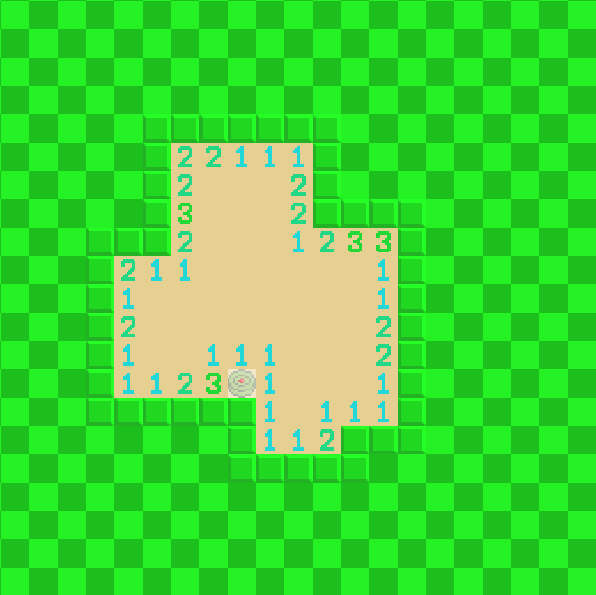
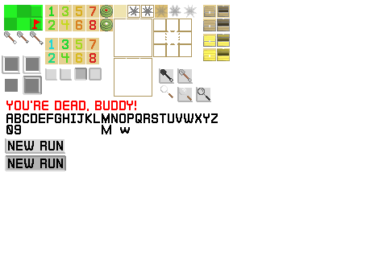

# Roguelike Minesweeper Project
This project is a currently unfinished attempt at creating an infinite, roguelike Minesweeper clone.
In its current state, the gameplay consists of an infinitely expanding Minesweeper board, and mines do not end the game when clicked.
---
\
*In-game screenshot
---
\
*Concept sprite sheet
---
